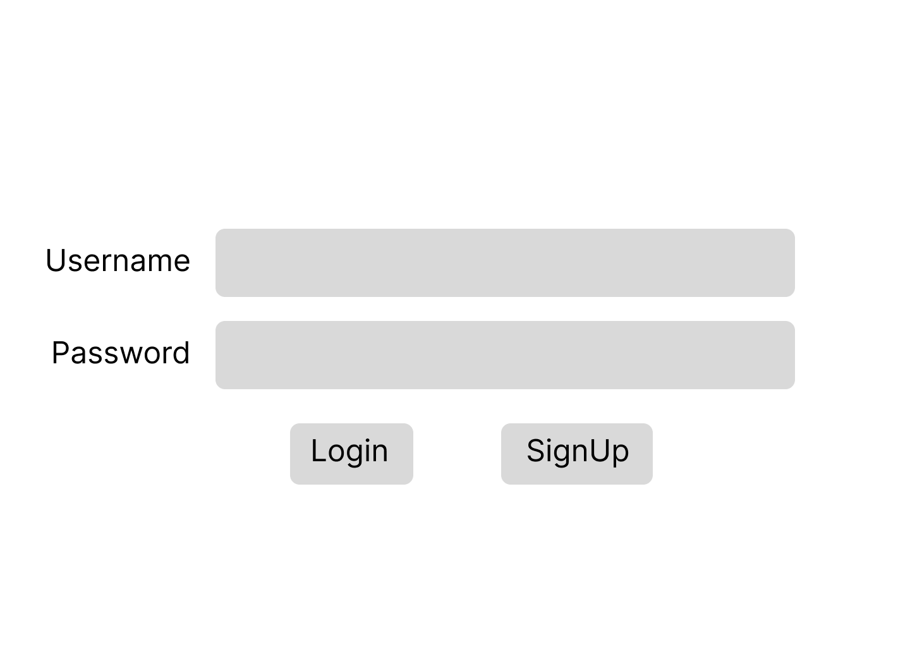
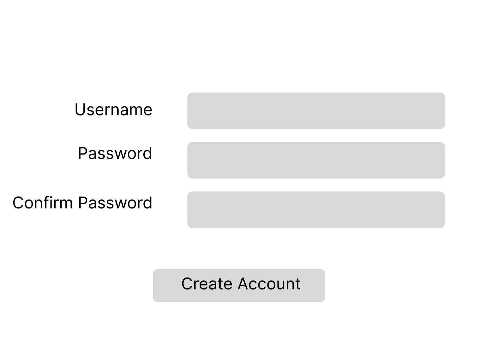
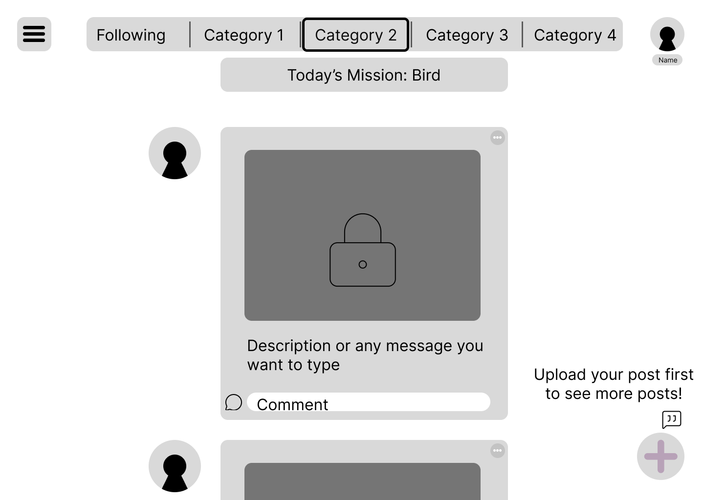
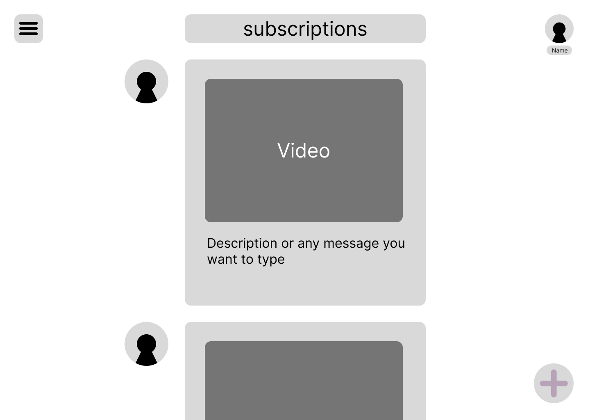
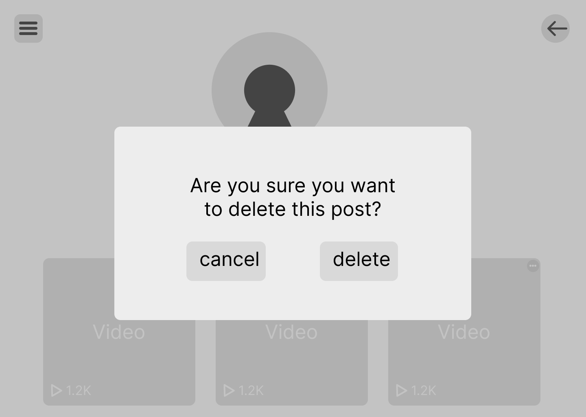

#Module 1 Group Assignment

CSCI 5117, Fall 2026, [assignment description](https://canvas.umn.edu/courses/579310/pages/project-1)

## App Info:

* Team Name: Peter Parkers
* App Name: Missions (tentative name)
* App Link: [https://developing-the-interactive-web-project-1-q87a.onrender.com/]

### Students

* Jeonghyo Kim, kim02607
* Kelvin Pang, pang0161
* Salman Hussein, husse347
* Xuan Gu, ehrma055
* Donald Huynh, huynh338

## Database setup

Add `DATABASE_URL` to `.env`, then run:

```powershell
uv sync
uv run run_schema.py
```

This sets up or updates the database in `.env` and keeps the existing data.
Only run it when setting up or changing the tables.

## Key Features

**Describe the most challenging features you implemented
(one sentence per bullet, maximum 4 bullets):**
* The website uses the third-party Open-Meteo API to retrieve real-time weather data and dynamically update the page background to match the current weather conditions.(Also, if you don't like the current background, you can change it yourself!)
* We use Amazon S3 to upload videos and images for posts and profile images
* Use AJAX and JavaScript to update likes, comments, and subscriptions without reloading the page, with instant like feedback and error recovery
* Well executed responsive design

## Testing Notes

**Is there anything special we need to know in order to effectively test your app? (optional):**
* To unlock all features, please log in. Without logging in, you can only browse limited content.
* ...


## Screenshots of Site

**[Add a screenshot of each key page (around 4)](https://stackoverflow.com/questions/10189356/how-to-add-screenshot-to-readmes-in-github-repository)
along with a very brief caption:**


## Mock-up 

* Link: [https://www.figma.com/design/luParcBqdCh4ywY9Jmwp9h/Test-Project?node-id=0-1&m=dev&t=DNVU6SZXRvBktKUJ-1]

<!-- **[Add images/photos that show your paper prototype (around 4)](https://stackoverflow.com/questions/10189356/how-to-add-screenshot-to-readmes-in-github-repository) along with a very brief caption:** -->

<!--  -->
### Log-in/Sign-up
We used figma to make a mock-up of our mission based, user engagement focused microblogging website.  
The first two images of our mock-up show simple log-in/sign-up pages



### Homepage
Once past that, we see a typical feed. We want a mechanism for people to be able to engage and self-moderate. Think, reporting system + popular posts survive per category (maybe?).

On clicking the meatball menu, we're given a few options for a post.

A look of the comment section.

After users have viewed a certain number of missions (maybe 3?), they will be temporarily blocked from viewing more missions until they upload their own daily mission.



### Upload
When you click "Upload," you'll be taken to this screen.You can upload your content and edit the text here. Of course, you can always go back by clicking the arrow in the top-right corner.


### Menu
Here's a view of the expanded hamburger bar.

When you click "Home," you'll return to the homepage (as shown earlier). When you click "Mission Tracking," you'll be taken to the following screen(this is still under consideration so we might not go with a mission tracking page.).

When you click "Subscriptions," you'll be taken to the Subscriptions page, which is dedicated to displaying content from users you've subscribed to.


### Profile Pages
When you click "Profile" in the menu or just Click on your profile picture (usually in the top-right corner), you'll be taken to your personal profile page. "Liked Videos" and "Your Videos" are also sections within the Profile page, as shown below.


On clicking any of your videos' meatball menu, you can edit, delete, or share. (for now...)



No options meatball menue for other users, clicking a video should bring you back to a view of a video, similar to the default homepage view(Oh, and by the way, you can also visit other users' profiles by clicking on their profile pictures on the homepage.).


## External Dependencies

**Document integrations with 3rd Party code or services here.
Please do not document required libraries. or libraries that are mentioned in the product requirements**

* [weather-effects-js](https://github.com/c3nk/weather-effects-js) 1.0.1: renders the animated sun, cloud, rain, snow, fog, and lightning background effects. The project declares an MIT license.
* [Open-Meteo](https://open-meteo.com/): its free non-commercial API provides the daily Minneapolis WMO weather code that selects the background effect. Weather data is licensed under CC BY 4.0.

**If there's anything else you would like to disclose about how your project
relied on external code, expertise, or anything else, please disclose that
here:**
* [https://github.com/021gink/short-drama-ai-skills]: Create your own videos!

...
